# Amplia · Diário de desenvolvimento

> **Fisioterapia em casa, medida em graus.**
> O paciente treina com a câmera do celular. A Amplia corrige o movimento, conta só as repetições bem feitas e mostra a evolução para o fisioterapeuta.

**App no ar:** https://amplia-pearl.vercel.app

Este repositório é o **diário público** do projeto: o passo a passo de como a Amplia foi pensada e construída, com imagens de cada fase. **O código-fonte é privado e não está aqui.**

---

## Índice

- [A ideia](#a-ideia)
- [Dia 1 · 10/10/2026: do zero ao primeiro app no celular](#dia-1--10102026-do-zero-ao-primeiro-app-no-celular)
- [Dia 2 · 14/10/2026: contas, painel da clínica e visual futurista](#dia-2--14102026-contas-painel-da-clínica-e-visual-futurista)
- [Decisões que guiaram o projeto](#decisões-que-guiaram-o-projeto)
- [Como funciona por dentro (sem código)](#como-funciona-por-dentro-sem-código)
- [Próximos passos](#próximos-passos)
- [Créditos e licenças](#créditos-e-licenças)

---

## A ideia

Tudo começou com uma pergunta: **um aplicativo com câmera inteligente, que entende os movimentos do corpo, pode virar um negócio?**

A tecnologia para reconhecer o corpo pela câmera já existe e é gratuita. O valor está em **resolver um problema caro para quem paga**. Entre os setores avaliados (fisioterapia, ergonomia no trabalho, fitness, Libras, criadores de conteúdo, monitoramento de idosos), o escolhido foi a **fisioterapia em casa**:

- **O problema:** o paciente recebe exercícios para fazer em casa, mas faz errado ou não faz. O fisioterapeuta não tem como saber.
- **Quem paga:** clínicas e profissionais (modelo B2B, por assinatura).
- **A solução:** o celular vira um "fisioterapeuta de bolso" que mede o movimento em graus, corrige na hora e manda a evolução para a clínica.

---

## Dia 1 · 10/10/2026: do zero ao primeiro app no celular

### 1. Primeiro protótipo
Um app que roda no navegador, com a câmera reconhecendo **33 pontos do corpo**, medindo o **ângulo da articulação** e contando **só as repetições com amplitude correta**. Três exercícios: agachamento (joelho), elevação lateral (ombro) e flexão de cotovelo.

Também tinha um **gêmeo digital** (um avatar que copia o movimento) e um **painel de exemplo da clínica**.

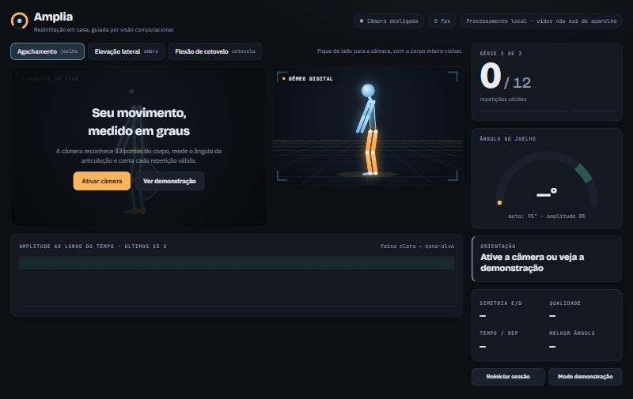
*Tela inicial: câmera, gêmeo digital, contador e medidor de ângulo.*

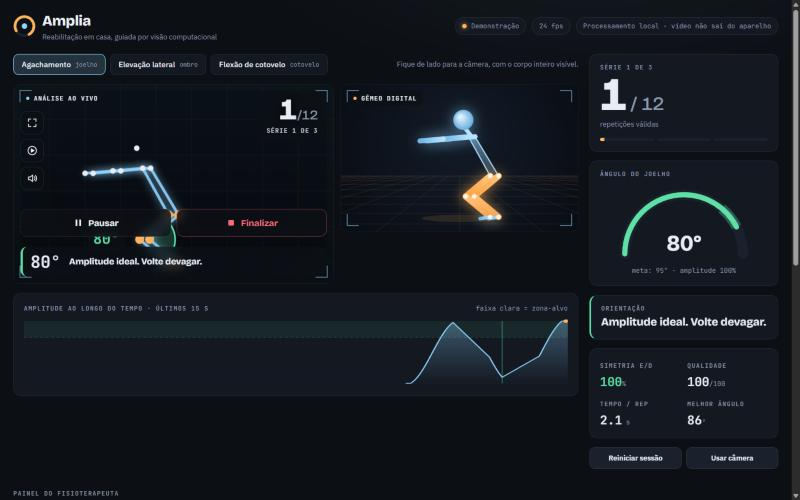
*Modo demonstração: esqueleto com o ângulo do joelho, gráfico da amplitude e a repetição contada.*

### 2. Do computador para o celular
O computador do criador não tinha webcam, então o app virou um **aplicativo de celular** desde o primeiro dia:
- publicado na **Vercel**, com endereço seguro (https), condição para a câmera funcionar no celular;
- **instalável na tela inicial** (PWA), abrindo em tela cheia como um app de loja.

### 3. Testes reais no iPhone e o que mudou por causa deles
Os primeiros testes de verdade mostraram problemas que só aparecem na prática:

| O que aconteceu no teste | O que foi feito |
|---|---|
| "Não aparece qual movimento eu preciso fazer" | **Guia animado** antes de começar, com 3 passos e contagem 3-2-1 |
| A 1 metro do celular, não dava para ler se acertou ou errou | **Voz, som, borda piscando verde/vermelho e ✓/✕ gigantes** |
| A voz do navegador não tocava no iPhone | **Voz gravada** em português, com som mais humano |
| Faltava controle durante o treino | Botões **Pausar, Continuar e Finalizar** e **tela de resultado** |
| Perto demais da câmera, nada acontecia | **Silhueta tracejada** mostrando onde ficar + voz "Afaste-se" |

  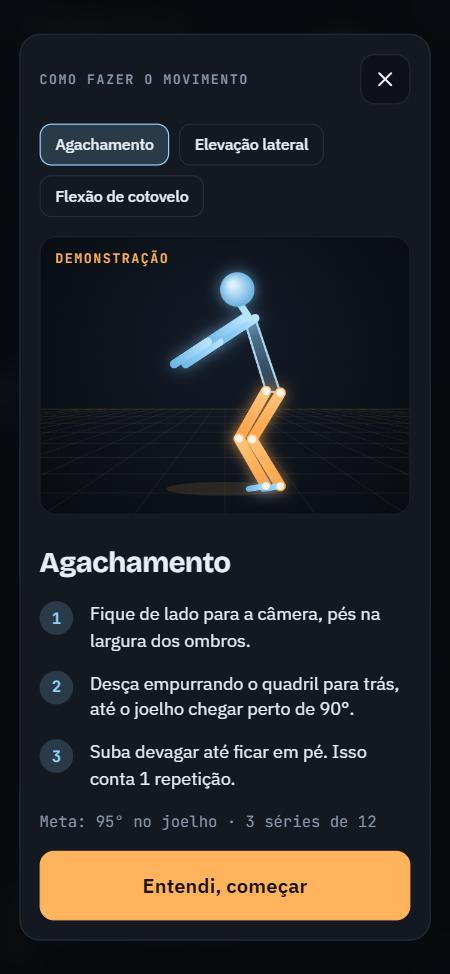
  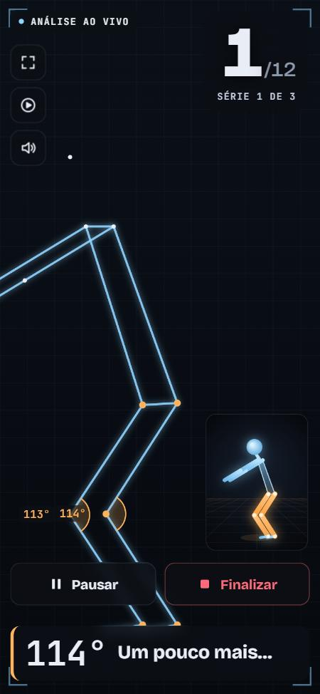
  

*Guia do movimento · treino em tela cheia com orientação ("Um pouco mais…") · resultado do treino.*

### 4. Organização profissional
- Código em **repositório privado no GitHub**, com histórico de cada mudança.
- **Publicação automática:** cada mudança salva no GitHub vai ao ar sozinha em cerca de 15 segundos.

---

## Dia 2 · 14/10/2026: contas, painel da clínica e visual futurista

### 5. Psicologia das cores
Pesquisa rápida sobre cores e motivação. Conclusão: a paleta já combinava com o público (gente em reabilitação, muitas vezes com dor ou insegura):
- **azul-gelo** → confiança e calma (saúde, tecnologia);
- **âmbar** → energia e otimismo, sem assustar;
- **verde** → acerto e recompensa.

Também ficou registrado que o vermelho deve ser reservado para riscos de verdade, e que **cor nunca anda sozinha**: sempre há símbolo e voz junto, por causa do daltonismo.

### 6. Contas: fisioterapeuta e aluno
Login com **usuário e senha** e duas experiências diferentes:

- **Fisioterapeuta / professor:** recebe um **código** (ex.: `AMP-XXXX`) para os alunos se ligarem a ele, ou **cadastra o aluno** (pensado para idosos que têm dificuldade com cadastro).
- **Painel do fisioterapeuta:** quem **concluiu o treino do dia**, quem **fez parte**, quem **precisa de atenção** (ex.: "sem treinar há 4 dias"), histórico de cada sessão e um botão de **WhatsApp com mensagem pronta** para lembrar ou parabenizar.
- **Tela do aluno:** o treino de hoje com porcentagem, a semana e os últimos treinos. O treino feito com a câmera é **salvo automaticamente** e aparece para o fisioterapeuta.

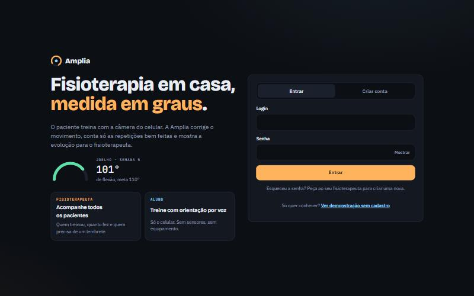
*Tela de entrada com login e cadastro.*

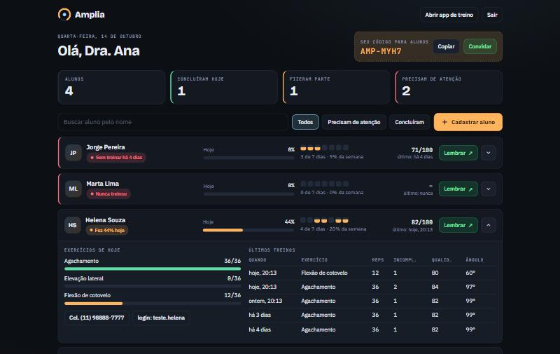
*Painel do fisioterapeuta (dados fictícios de demonstração): os alunos que precisam de atenção aparecem primeiro.*

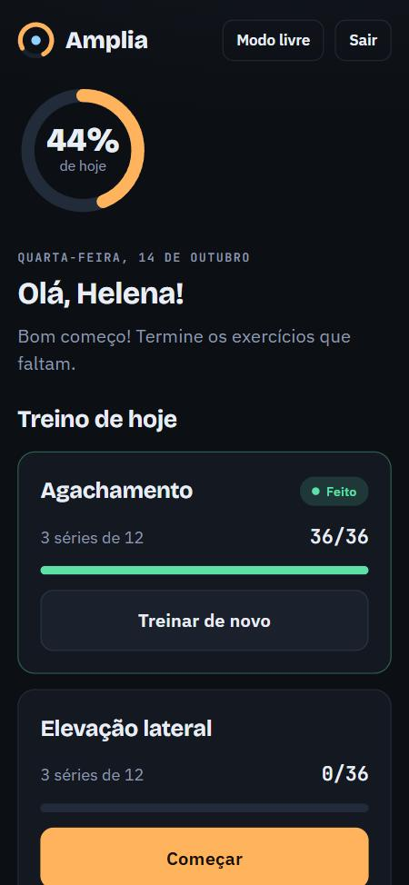

*Tela do aluno no celular (dados fictícios).*

### 7. Visual futurista: a evolução do corpo 3D
O objetivo: algo que **impressione na primeira tela**, com um corpo humano 3D fazendo os exercícios e a câmera dando zoom na articulação em uso. Foram quatro versões até chegar no resultado:

**Versão A: holograma de pontos.** Uma nuvem de pontos em forma de corpo, desenhada em 2D.

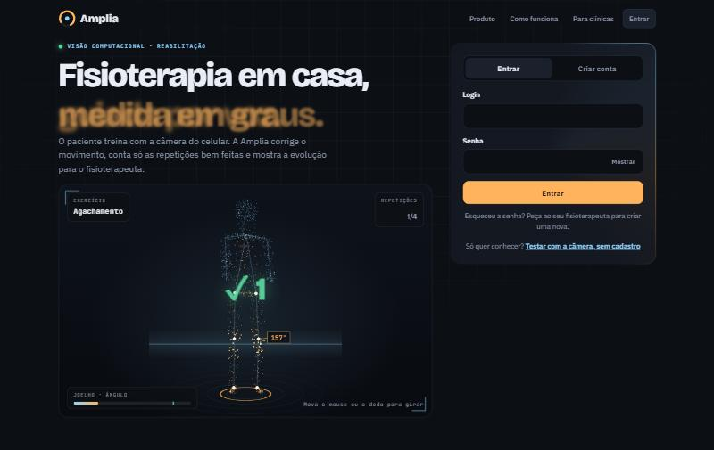

**Versão B: corpo 3D de peças.** Primeiro corpo em 3D de verdade, com câmera em movimento e zoom no joelho. *Feedback: "parece um boneco", e passava por cima do texto.*

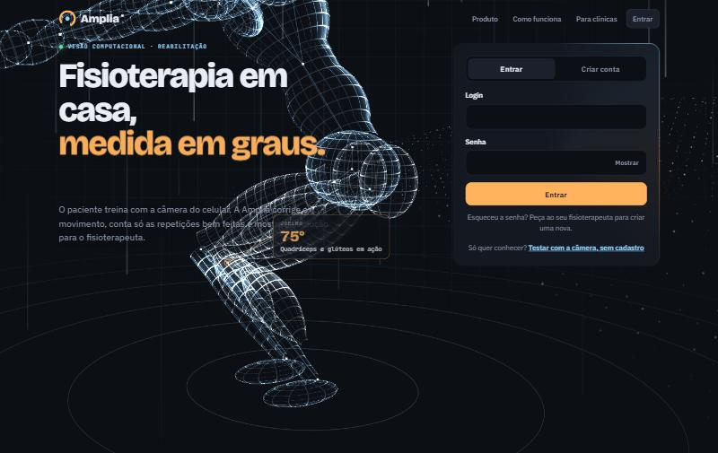

  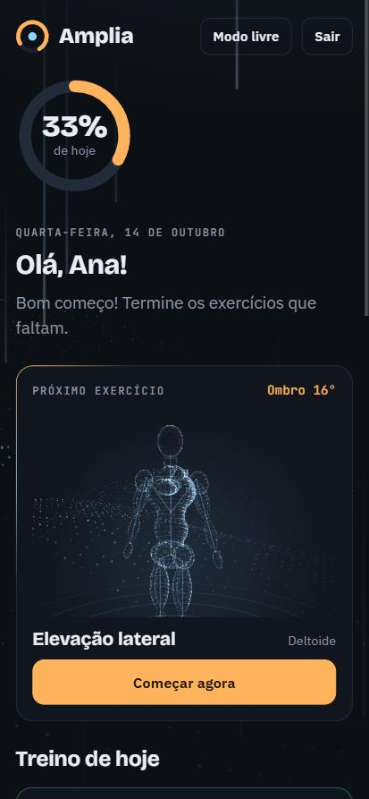
  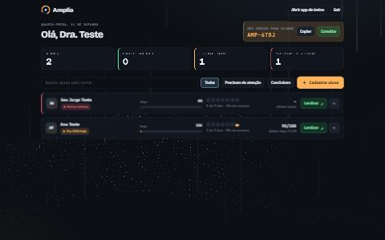

*O corpo 3D também entrou na tela do aluno (próximo exercício), e o fundo das telas ganhou partículas e feixes de luz.*

**Versão C: manequim.** Pele contínua e grade de luz, posicionado abaixo do título. *Feedback: "parece balão", queria algo mais anatômico.*

  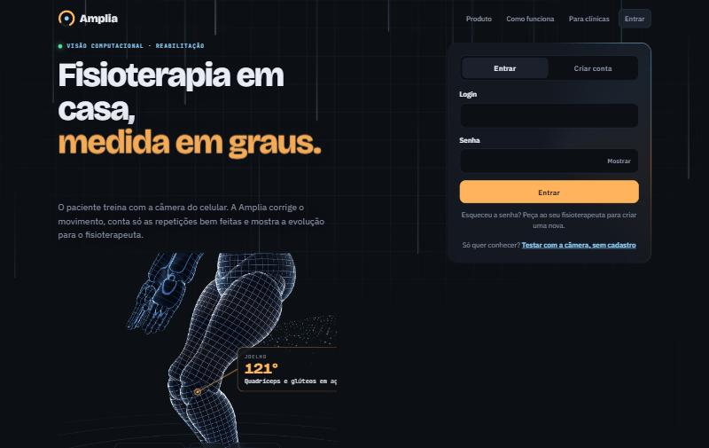
  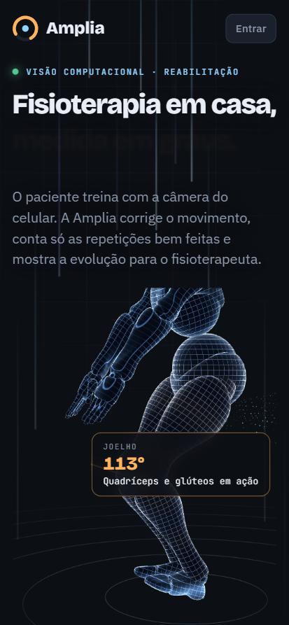

**Versão D (atual): corpo anatômico masculino em malha de luz.** Um corpo humano real, masculino e musculoso (sem partes íntimas), desenhado como um **escaneamento 3D**: a malha de quadradinhos segue a musculatura.
- Os **músculos em uso acendem em âmbar** (coxas e glúteos no agachamento, ombros na elevação, bíceps na flexão).
- A câmera **gira e dá zoom na articulação**, mostrando o ângulo ao vivo.
- **Efeito retrato do iPhone:** o corpo passa por trás do título, mas desfocado, e fica nítido logo abaixo, onde está o foco. Chama atenção sem atrapalhar a leitura.

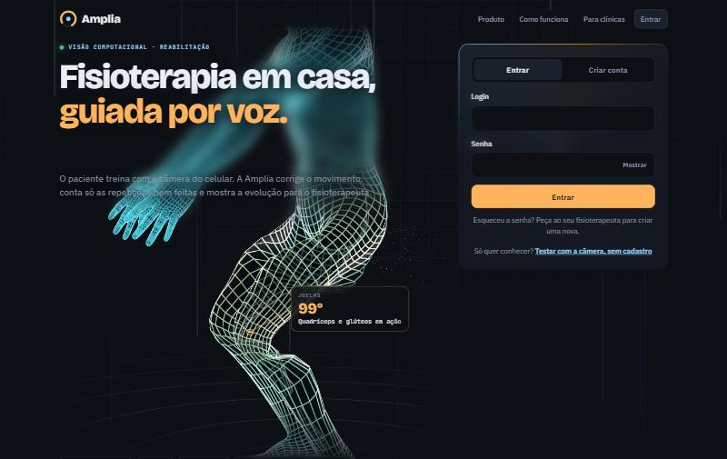
*Agachamento com zoom no joelho (99°). A parte de cima do corpo aparece desfocada atrás do título.*

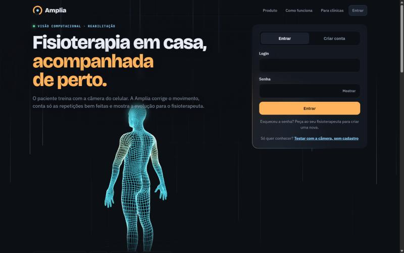
*O corpo inteiro, com a malha de luz seguindo a anatomia.*

---

## Decisões que guiaram o projeto

| Decisão | Por quê |
|---|---|
| Fisioterapia, vendendo para clínicas | Dor clara, quem paga é empresa, pouca concorrência no Brasil |
| App no navegador, instalável (PWA) | Sem depender de loja de apps; funciona em iPhone e Android com um link |
| A análise do vídeo acontece **no próprio celular** | Privacidade (LGPD): o vídeo nunca sai do aparelho, só os números do treino |
| Feedback por voz, som e sinais grandes | Quem treina fica longe do celular e não consegue ler a tela |
| Contar só repetições com amplitude correta | O valor para a clínica é a **qualidade** do exercício, não só a quantidade |
| Aluno pode ser cadastrado pelo fisioterapeuta | Muitos pacientes são idosos |
| Visual futurista com corpo 3D | Primeira impressão em apresentações para clínicas e investidores |

---

## Como funciona por dentro (sem código)

- **Visão computacional no aparelho:** um modelo de inteligência artificial identifica 33 pontos do corpo em tempo real. A partir deles o app calcula o ângulo das articulações.
- **Contagem inteligente:** cada repetição só conta quando o movimento chega na amplitude-alvo e volta. Se faltar amplitude, o app avisa.
- **Servidor e banco de dados:** contas, treinos e o painel ficam num banco de dados na nuvem (região São Paulo). As senhas são guardadas com criptografia.
- **3D no navegador:** o corpo humano é animado em tempo real no próprio navegador, sem vídeo pré-gravado.
- **Publicação automática:** cada mudança no código vai ao ar em segundos.

O projeto foi desenvolvido com apoio de IA (Claude Code, da Anthropic), conduzido pelo criador a partir de testes reais no celular.

---

## Próximos passos

- **Clínicas:** cada clínica com sua conta, seus profissionais e sua identidade visual (logo e cores).
- **Lembretes automáticos** por WhatsApp e e-mail para quem não treinou.
- **Plano personalizado** por paciente (exercícios, séries e amplitude-alvo definidos pelo fisioterapeuta).
- **Mais exercícios** e tempo de descanso entre séries.
- **LGPD:** termo de consentimento e contrato com as clínicas.
- **Marca:** domínio próprio, registro do nome e voz profissional (ou gravada por um fisioterapeuta).

---

## Créditos e licenças

- Detecção de pose: **MediaPipe** (Google), licença Apache 2.0.
- 3D: **Three.js**, licença MIT.
- Corpo anatômico: **MakeHuman**, licença CC0 (domínio público).
- Voz do protótipo: voz neural da Microsoft (pt-BR). Para a versão comercial será usada uma voz licenciada ou gravada.

---

© 2026 Amplia. Todos os direitos reservados. Este repositório contém apenas documentação e imagens do projeto; o código-fonte não é público.
